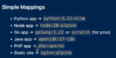
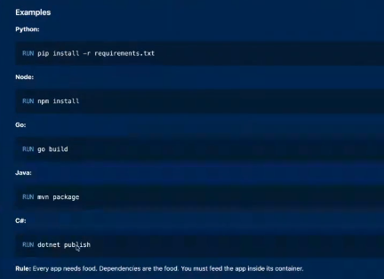
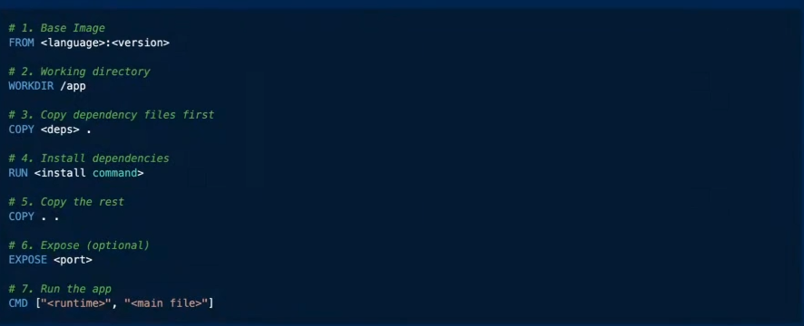
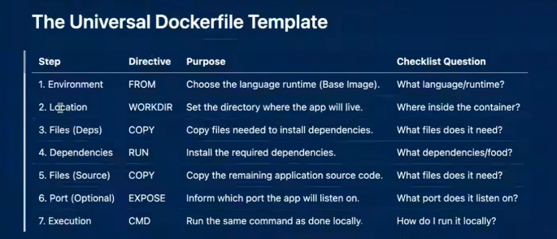

# Docker in action - Job process

ADVANCED - 1 - CONTAINERS FROM SCRATCH VIDEO IN MODULES

- When you start a job, as a Devops Engineer, the first step is the developer giving you an application file. That file is the application you need to containerize etc. 

## Docker needs 4 main things to be able to run a container successful: 

1. Base Image
2. Application
3. Dependencies
4. Entrypoint


## IN A REAL JOB: PROCESS

### Need to know how to run that application in the terminal! Without anything else first. 
   
- NEED TO KNOW HOW IT RUNS BECAUSE OTHERWISE WON'T KNOW HOW TO RUN IT INSIDE A CONTAINER!
  
- Find the entrypoint of the application.

- This looks different depending on what type of application it is.

   - `python app.py` = python application.
   - `node index.js` = Node
   - `go run app.go` = Go
   - `mvn package` `java -jar target/app.jar` = Java
   - `dotnet run` = C#
   - Etc etc (php etc)

- Once this command is ran (Compiled languages) and the application runs, it creates a binary. 
- BINARY = THE APPLICATION!

- THAT BINARY CAN BE PUT INSIDE A CONTAINER AND THE CONTAINER WILL WORK.

- Python and Node = not compiled. 
  - Heavy applications.

- Compiled languages = Java etc 
  - Light applications.


1. Choosing the Base Image 
   - It typically provides the minimal operating system environment, core filesystem structure, and foundational utilities that your application needs to run.
   - Need to know the type of application you're running. 
   - You choose the base image based on the language the app needs. Simple. 



- Some images are lighter and some are heavier. 
- E.g. slim is lighter/smaller.
- Some applications may not work with the slim base image. 
  - This is because some apps may need additional libraries etc that aren't included in a slim. 
- E.g. alpine = misses libc etc important libraries for some apps to run.
  - Works with go and node.
  - Doesn't work with python application - breaks python dependencies and libraries. 

- Distroless - minimal files, no shell.
- Scratch = no shell.

- Python = heavy language - bigger. 


2. APPLICATION 

- Need 2 files:
  - requirements.txt - e.g. just includes `flask` - Need to install the requirements. 
    - Different dependent on language - e.g. `package*.json .` for node app.
  - app.py (the application) - run the application. 
    - The port must be specified in the app. 


The dockerfile:

```
FROM python:3.12

WORKDIR /app 

COPY requirements.txt

RUN pip install --no-cache-dir -r requirements.txt

COPY . . 

EXPOSE 5000

CMD ["python", "app.py"]


```

- If don't set a directory (WORKDIR), it works in the root directory - not ideal.
- Installs the dependencies from requirements.txt file. 
- `no-cache-dir` = Normally pip saves the files it downloads in a storage area (a “cache”) so it can reuse them later. Inside a container you’ll never need them again, so keeping them would just make the image bigger for no reason. This option throws them away.


- Copied the requirements.txt first and then copy the app after. 
  - This is so rebuilding is faster. 
  - Docker builds in layer. Each line in docker creates a saved checkpoint. 
  - If nothing has changed, docker skips to the next step and reuses the previous step. 
  - The app code (app.py) changes all the time, every time you fix a bug or add a feature.
  - The dependency list (requirements.txt) rarely changes. You only add a new package now and then.
  - Installing packages is slow. So don't want to be going through everything each time. (As soon as it finds something that changed, it has to redo that step and every step after it.)


- `EXPOSE 5000` = This is just for documentation. 
    - Even without this command, the container will run. 
    - It's just for users to know which port it uses.
    - The port actually gets opened through the command of `docker run -p` and specify the port.  
    - The port is also mentioned 

- Another command for dockerfile = `ADD`
  - Same as COPY but can retrieve URLs. 
  - Not trusted - URL is always changing/external resource. 


1. DEPENDENCIES
   - The app's tools and room essentials. 
   - The app needs it's dependencies. 
  

 


4. ENTRYPOINT

- Use entrypoint (command to run app) inside the container. 
- In dockerfile - use CMD and place the commands:
  - E.g. `CMD ["python", "app.py"]`
  - E.G. `CMD ["node", "index.js"]`
  - These are the same commands ran locally to run the applications. 

- Another way of doing entrypoint = bash script. Old way of doing this. 
- Container is mostly linux. 


## RUN VS ENTRYPOINT VS CMD

- CMD = default command - Runs when container starts and doesn't run again - can be overwritten.
  - CMD is a default that’s easy to replace. If someone starts the container and types a different command, their command wins and CMD is ignored.


- Entrypoint = set in stone.
  - ENTRYPOINT is fixed. The container always runs it, and anything extra someone types gets added on the end rather than replacing it. (It can be overridden, but only by deliberately using a special option.)


- RUN is for setting things up. It runs once, during the build, and the result is saved into the image. Examples: installing packages, creating folders.
- RUN can also be used for permissions - chmod. 


## PUT IT ALL TOGTHER: TEMPLATE:







## PORTS

- E.g. -p 5000:5001

- 5000 is the port you run on your machine.
  - This can change as it's on your machine. 

- 5001 is the port you run on the container. 
  - This port must match the port you open via application 
  - This is also the port documented in the dockerfile.


## Docker checklist

1. How do I run it locally? - becomes CMD.
2. What language does it use? - becomes base image.
3. What file does it need? - becomes COPY.
4. What dependencies does it need? - this becomes RUN.
5. Where should the app live inside the container? - this becomes WORKDIR.
6. What port does the app listen on? - becomes EXPOSE.
7. Does it need any settings? - becomes ENV.
8. Should it run as a safe, limited user? - becomes USER.
9. What files should be left out? - becomes .dockerignore.
10. Does it need building first (compiled languages)? - becomes a multi-stage build.


## What makes a good production-like Dockerfile?


These are my 3 core principles for writing production-like Dockerfiles:

- Small: minimize image size
  - faster builds
  - faster pulls
  - faster ECS cold starts
  - fewer CVEs

- Secure: minimize attack surface
  - non-root user
  - minimal OS
  - no package managers in final image
  - limited attack sur

- Predictable: build consistently
  - pinned versions
  - pinned image tags
  - stable layers
  - deterministic builds

If these aren't met, you cannot call it a production-like Dockerfile.
