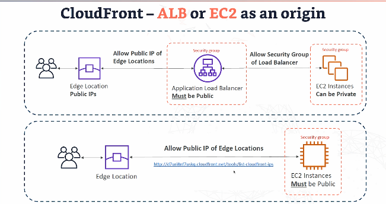

# CLOUDFRONT

- Content delivery network.
- Improves read performance. 
- Content is cached at the edge. 
- Improves user experience. 
- DDoS protection. 

## Cloudfront at a high level

1. Request is sent from client to the server.
2. Cloudfront acts - if the data is in cache it can return data straight away - at edge location.
3. If not cached, cloudfront reaches out to origin and origin sends data to cloudfront. 
4. This speeds up content delivery - cloudfront caches the data at the closest possible edge location. 

## Origins

- S3 Bucket 
  - For distributing files and caching them at the edge. 
  - Enhanced security with cloudfront origin access control (OAC).
  - OAC - replacing Origin Access Identity (OAT).
  - Cloudfront can be used as an ingress - to upload files to S3. 

- Custom Origin (HTTP)
  - ALB
  - EC2
  - S3 Website - first enable the bucket as a static S3 website.
  - Any HTTP backend you want. 

## S3 As An Origin

- Stores files - images/videos. 
- Scattered across the globe - cloudfront edge location. 
- If you're using Private AWS (the connection between aws and s3 bucket runs over aws private network not the public internet),and bucket policies, only cloudfront can access the s3 content directly - extra layer of security. 
- Quick, secure content delivery. 

## ALB And EC2 as an origin 

- Users connecting to edge location closest to them on cloudfront. 
- Requests go to Public facing load balancer / ec2.
- ALB needs to be public - sg should allow public IP of edge locations. 
- EC2 needs to allow public IP of edge locations. 

