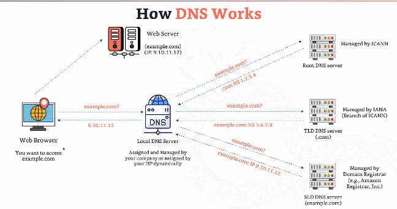
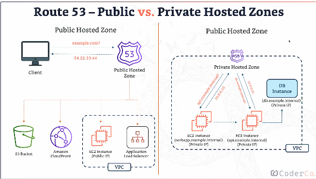

# DNS

- Domain Name System which translated the human friendly hostnames into the machine IP addresses. 

## The basics

- DNS: the internet’s phone book. Turns names into IP addresses.
- Domain: the name, like myshop.com.
- Subdomain: anything in front, like www or api.
- TLD: the ending, like .com or .uk.

## Who does what

- Registrar: where you buy the domain.

- Resolver: does the looking-up for you.
    - The resolver is the one doing the asking on your behalf. Your computer doesn’t search the internet for an address itself. It just asks the resolver, “where is myshop.com?” and waits.

    - The resolver then goes off, asks the right servers, and comes back with the answer. It also remembers answers (for as long as the TTL says), so it doesn’t have to ask again every time.
  

    - You usually don’t choose it. It’s normally run by your internet provider, or inside AWS, every VPC has one built in.

- Name server: answers lookups.
    - A name server is any server that answers DNS questions. It’s a general term.
  
    - Some name servers don’t have the final answer, but they can point you in the right direction. For example, the .com name server doesn’t know myshop.com’s IP address, but it knows who does, and says “go and ask them.”

- Authoritative name server: has the official answer for your domain.

  - This is the name server that holds the official, final answer for a specific domain. It’s not pointing you somewhere else; it actually has the records.

  - When you put your domain’s records into Route 53, Route 53’s servers become the authoritative name servers for your domain. So when anyone in the world asks about myshop.com, the question eventually ends up at Route 53, and Route 53 gives the real answer.

## Where records live

- Hosted zone: the list of all records for one domain (Route 53’s word for it).
- Zone apex: the bare domain with nothing in front, like myshop.com.

## Record types

- A: host name → IP address.
- AAAA: name → newer, longer IP address  - IPV6.
- CNAME: name → another name. Can’t be used on the root domain. 
- Alias: name → AWS resource (like a load balancer). Works on the bare domain.
- MX: where email goes.
- TXT: text, mostly to prove you own the domain.
- NS: which name servers are in charge.

### CNAME
- AWS resources expose a AWS hostname. 
- CNAME records point a hostname to any other hostname. 
- Only for non-root domain. 

### ALIAS
- Points a hostname to an AWS resource.
- Words for root and non-root domain. 
- Free.
- Native health check. 
- can't set TTL.
- You can't set alias record for ec2 dns name. 

## How does DNS work?

1. Type example.com. 
2. The request goes to local DNS server. 
3. If the DNS local server doesn't have the IP cached, it asks the Root DNS server.
4. The root server points to the next server - the TLS DNS server.
5. The TLS DNS server sends local server to the SLD DNS server. This is where the IP is found. 

## ROUTE 53

- Highly available, scalable, fully managed and authoritative DNS. 
- Similar to what cloudflare does.
- Authoritative = you can update the DNS records. 
- It's also a domain registrar.
- Ability to check the health of your resources. 
- The only AWS service which provides 100% SLA. 
- 53 is a reference to the traditional DNS port. 

## Route 53 - Hosted Zones

- A container for records that define how to route traffic to a domain and it's subdomains. 
  
- Public hosted domains - contain records that specify how to route traffic on the internet (public domain names).
  
- Private hosted domains - contains records that specify how you route traffic within one or more VPCs (private domain names).
- You pay 50 cents per month per hosted zone. 

### Route 53 records

- How you want to route traffic for a domain.
- Each record contains:
  - Domain/subdomain name. 
  - Record type. E.g. A, or CNAME. 
  - Value. 
  - Routing policy - how route 53 responds to queries. 
  - TTL - amount of time the record cached at DNS resolvers. 
  

  ### Routing policies - don't get confused - route 53 doesn't route any traffic. 

  - Simple = most basic. Routes to a single resource.  
    - Can specify multiple values in a record. 
    - If multiple values are returned, a random one is chosen by the client.

  - Weighted
    - Control the % of requests that go to each specific resource. 
    - Weights dont need to sum up to 100. 
    - Assign a weight of 0 to a record to stop sending traffic to a resource.
    - If all are 0, records will be returned equally. 
    - E.g. load balancing between regions, testing new application versions.. 

  - Latency based
    - Redirect to the resource that has the least latency close to us.

  - Geolocation
    - based on user location.
    - Create a default record too - incase theres no match on location. 
    - E.g. restict content distribution, load balancing..

  - Geoproximity
    - Based on location of users and resources.
    - Ability to shift more traffic to resources based on the defined bias. 
    - Need to use route 53 traffic flow to use this feature.

  - IP based 
    - Based on clients IP addresses. 
    - You provide a list of CIDRs for your clients and the corresponding endpoints. 
    - E.g. route end users from a particular ISP to a specific endpoint. 

  - Multivalue 
    - Routing traffic to multiple resources. 
    - Up to 8 healthy records are returned for each multi-value query. 
    - Not a substitute for elb. 

### Health checks
- HTTP health checks are only for public resources. 
- Automated DNS failover. 

  1. Health checks that monitor an endpoint. 
  2. Health checks that monitor other health checks. 
  3. Health checks that monitor cloudwatch alarms. 
  4. Health checks are integrated with cloudwatch metrics. 

### TTL 
  - How long a DNS record is cached before it's refreshed. 
  - High TTL - records are cached for a long time - might be outdated. Cheaper. 
  - Low TTL - costs more, updated and DNS records are always fresh. 
  - Every record type except ALIAS records need to have TTL. 

