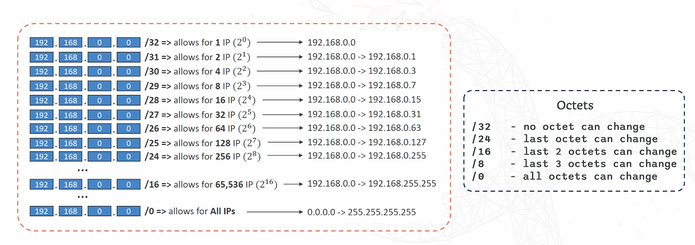
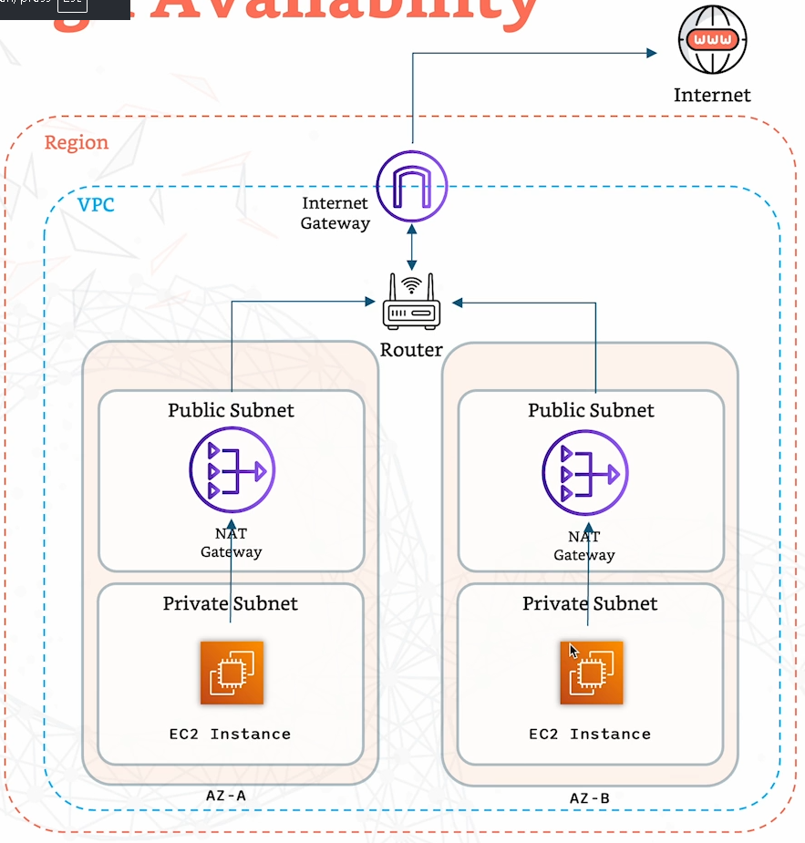
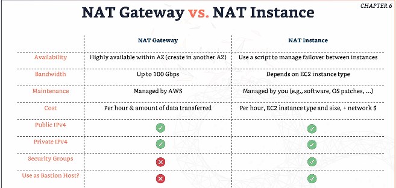

# AWS NETWORKING

## CIDR 

- Classless Inter-domain routing    
- A method for allowing IP addresses. 
- They help to define an IP address range.
- E.g. 192.168.0.0 to 192.168.0.63 = 64 IP addresses.

- AWS reserves 5 IP addresses for them. 
    - 1st IP is reserved for Network address.
    - 2nd IP reserved for VPC router.
    - 3rd IP reserved for mapping to Amazon provided DNS. 
    - 4th IP reserved for future use.
    - Last IP reserved for network broadcast address. AWS doesn't support broadcast in a VPC so its reserved. 

### 2 components:

1. Base IP
   - Represents the IP contained in the range. 

2. Subnet mask
   - Defines how many bits can change in the IP.
   - E.g. /0, /24, /32
   - The smaller the number, the larger the range of IPs. 

## Private IPs

- 10.0.0.0 to 10.255.255.255 (10.0.0.0/8) - In big networks
- 172.16.0.0 to 172.31.255.255 (172.16.0.0) - AWS default VPC in that range.
- 192.168.0.0 to 192.168.255.255 (192.168.0.0/16) - e.g. home networks. 

All the rest of the IP addresses on the internet are public. 

## VPCs 

### Default VPC 
- All new AWS accounts have a default VPC.
- New EC2 instances are launched into the default VPC if no subnet is specified. 
- Default VPC has internet connectivity and all EC2 instances inside it have public IP addresses. 
- Also get public and private DNS names. 

## Internet Gateway 

- Allows resources in a VPC to connect to the internet. 
- Scales horizontally and highly available and redundant. 
- Must be created separately from a VPC. 
- One VPC can only be attached to 1 IGW and vice versa. 
- Internet gateways alone don't provide internet access. 
- Route tables must also be updated. Route traffic from server to IGW. 

## Bastion Hosts

- Use a bastion host to SSH into our private EC2.
- The bastion is in the public subnet which is then connected to all other private subnets. 
- Bastion host security group = 
  - Must allow inbound from internet on port 22 from restricted CIDR - e.g. public CIDR of your company. This is so you can access the bastion host. 
- EC2 security group = allow the security group of the bastion host or the private IP of the bastion host, This is so we can access the EC2 through the bastion host.

## NAT Gateway 

- Allows instances in a private subnet to connect to the internet whilst blocking incoming traffic from the internet. 
- AWS managed NAT. 
- Created in a specific AZ - uses elastic IP. 
- Can't be used by instance in the same subnet - only from other subnets. 
- Requires IGW - Private subnet to NAT gateway to IGW. 
- No security groups to manage/required. 

NAT with high availability:

### NAT GATEWAY VS NAT INSTANCE

## NACL 

- Like a firewall which controls traffic to and from subnets.
- One per subnet. New subnets have default NACLs. 
  - They deny everything.
- Rules have numbers - lower numbers = higher precedence.
- Great way of blocking a specific IP at subnet level.
- Stateless - need to specific inbound AND outbound traffic. 
- Both directions explicitly. 

## Security Groups

- SG's operate at instance level - EC2 instances.
- NACL's operate at subnet level. 
- Security groups = stateful 
  - If you allow an incoming request, the response for the request is allowed automatically. 
  - Only need to specific traffic inbound. Automatically allowed outbound. 

Both NACL and SG rules must allow traffic for it to be allowed!!

## VPC Peering

- Privately connect 2 VPCs using AWS network. 
- Must not have overlapping CIDRs. 
- Not transitive - VPCs that aren't explicitly peered can't talk to eachother through another VPC. 
- You must update route tables in each VPCc subnets to ensure EC2 instances can communicate with eachother. 

- You can create VPC peering connection between VPCs in different AWS accounts/regions!

- You can reference a security group in a peered VPC (works across accounts - same region)

## VPC ENDPOINTS - AWS Privatelink

- Every AWS service is public exposed. They have a public URL. 
- VPC endpoints (powered by privatelink) allow you to connect to AWS services using a private network instead of the public internet. 

- They remove the need of IGW, NATGW to access AWS services. 
- Redundant and scales horizontally. 

To troubleshoot - 
  - Check DNS setting resolution in VPC. 
  - Check Route tables. 

### Types of endpoints
- Interface endpoints:
  - Provision an ENI (elastic network interface - private ip addresses) - as an entry point (must attach a security group).
  - Most AWS services supported. 
  - Not free. 

- Gateway endpoints 
  - Provisions a gateway and must be used as a target in a route table. 
  - Doesn't use security groups. 
  - Supports both S3 and dynamodb. 
  - Free. 

- Both types = private and secure. 
- No exposure to the internet. 

## IPV6 

- Successor of IPV4. 
- All public - no private addresses in AWS. 
- Resources are directly reachable over the internet unless secured if using IPV6.

- E.g. 2001.db8.3333.4444.5555.6666.7777.8888

- IPV4 can't be disabled for your VPC and subnets.
- You can enable IPV6 to operate in dual-stack mode. 
- Your EC2 instances will get atleast a private IPV4 and public IPV6. 
- They can communicate using either one of them to the internet through an internet gateway. 

## Egress-only Internet Gateway

- Only used for IPV6.
- Outbound communication only. 
- Similar to NAT gateway but only for IPV6. 
- You must update the route tables. 
- Direct the traffic from server to the gateway. 
- Good for restricting inbound connections but keeping outbound.

- IPV6 doesn't need NAT. 
Outbound traffic with IPV6 (both public subnet and private subnet) can just use the internet gateways fir