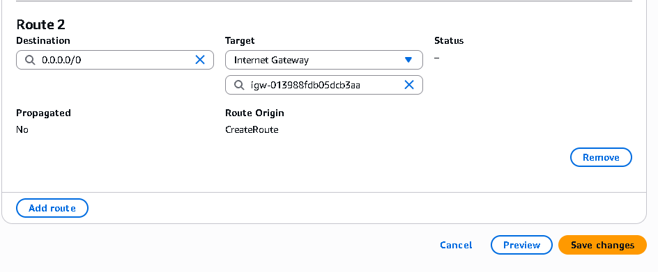
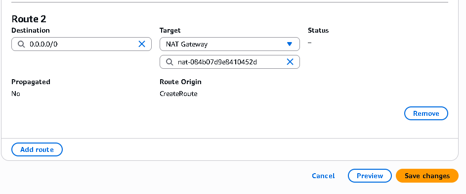
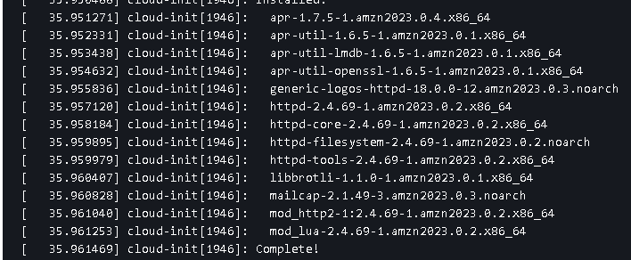
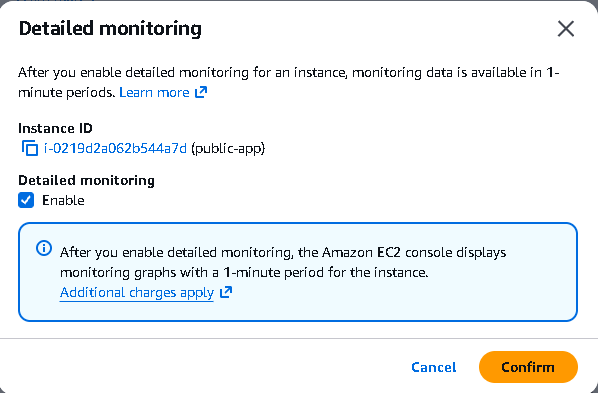

# Assignment 1 - VPC & Networking

A full custom network built from scratch. This teaches you the fundamentals of cloud networking, routing and segmentation.

## Objective

Create a custom VPC with one public and one private subnet, set up the correct routing for internet access, and deploy EC2 instances across them.


1. Create a VPC - 
   - CIDR: 10.0.0.0/16
   - Everything else default value. 

2. Create 1 public subnet:
    - Name: Public subnet
    - AZ: eu-west-2a
    - CIDR: 10.0.1.0/24 (256 IPs)

   - Create an Internet Gateway
     - Attach it to the VPC I created.

   - Create a route table
     - Attach it to the public subnet
     - Add a route in the route table - Outbound traffic going to the internet gets routed to the internet gateway.
     - Associate the route table to the public subnet. 

    


3. Create an EC2 instance (webserver) for the public subnet. 
   - Make sure it has a public IP. 
   - Ensure security group has SSH and HTTPS traffic allowed. 
   - Connected to my VPC, my public subnet. 
   - Add userdata so you can check if server is running!

```
#!bin/bash

yum update -y 
yum install -y httpd

systemctl start httpd
systemctl enable httpd

echo "<h1>Hello, I'm Zainab from the public app!</h1>" > /var/www/html/index.html

```

**TROUBLSHOOTING:**
- If something doesnt work / can't access the server on `http: public ip` - Check that the user data has ran properly!!
  - Select the instance → Actions → Monitor and troubleshoot → Get system log. 
  - Shows you what was happening inside the VM. 


WORKS! 


4. Create a private subnet and configure it for internet access:
   - Name: Private subnet
    - AZ: eu-west-2a
    - CIDR: 10.0.2.0/24 (256 IPs)

   - Create a NAT Gateway and put it in the public subnet.
     - Allocate elastic IP. 
     - Zonal. 

   - Create a route table
     - 1 route for all traffic to the NAT gateway.
     - Associate to the private subnet.





5. Create a private application that is still accessible on the internet. 
   - Private = no public IP. 
   - Connected to the VPC and private subnet. 
   - Doesn't need any extra security group rules etc. 
   - Add the user data here too.


    - This is private - 
      - The private instance can reach out to the internet, for example to download updates, but nothing on the internet can reach in to it.
      - To check it's working - check system logs of the VM through portal. 
      - instance → Actions → Monitor and troubleshoot → Get system log. 
      - It was able to install different packages and httpd - shows it could access the internet. Put won't be able to be accessed through internet!

WORKS!




## BONUS

ACCESSING THE PRIVATE SERVER: 

- From your home computer → private IP: doesn’t work. Your computer is on the internet, outside the VPC, so it has no route to 10.0.2.x. So, you can't ssh using the private IP of the EC2 from your own computer. 
  
- From the bastion → private IP: works. The bastion is inside the VPC, so it can reach the private server directly.
  
1. Deploy a Bastion Host to access the private EC2
   - This is for connecting to the private server through another server (called a bastion host).
   - Needs a key pair so can ssh into it. 
   - Needs to be in the public subnet. 
   - Assign public IP. 
   - Allow SSH in security group - from my IP. 
   - IMPORTANT:
     - In the private EC2 Security group, add a rule to say allow SSH from the source of the bastion's security group. That means “only accept logins coming from the bastion”.
   - Make sure the private server also has a key pair. (Bastion needs it to ssh into the private server).


2. Enable CloudWatch monitoring on instances

   - Basic CloudWatch monitoring is already switched on for every EC2 instance. AWS records things like CPU usage and network traffic every 5 minutes, for free. You can see it now: select an instance and open the Monitoring tab.

   - Enable CloudWatch monitoring - means detailed monitoring, which records the same things every 1 minute instead of every 5.

- On an instance that’s already running:

  - Go to EC2 → Instances and select the instance.
  - Click Actions → Monitor and troubleshoot → Manage detailed monitoring.
  - Tick Enable, then click Confirm.


