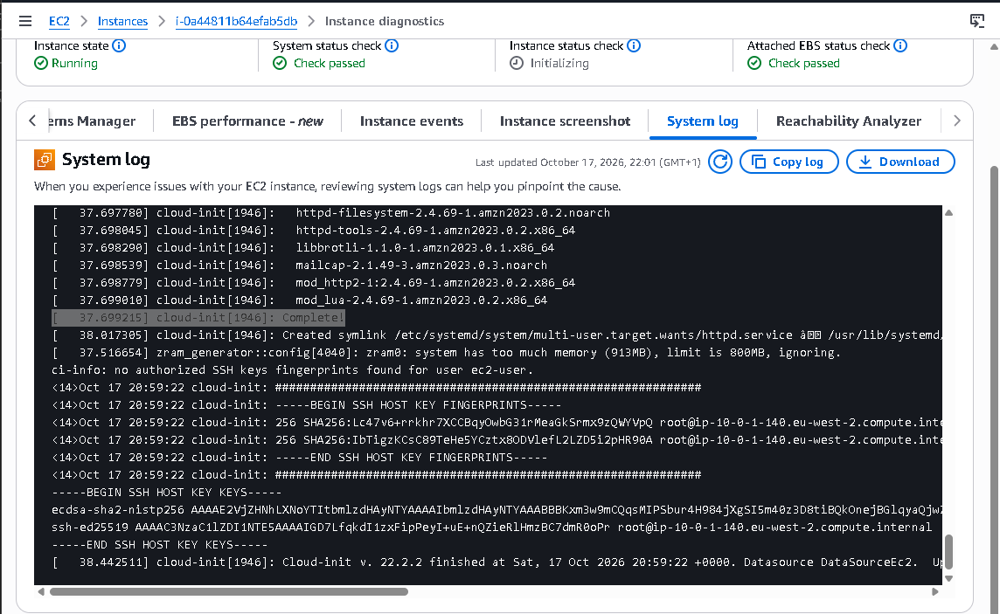
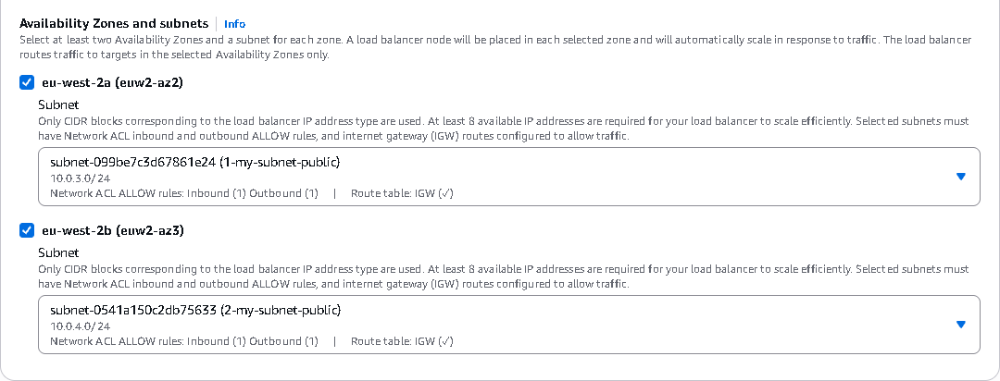
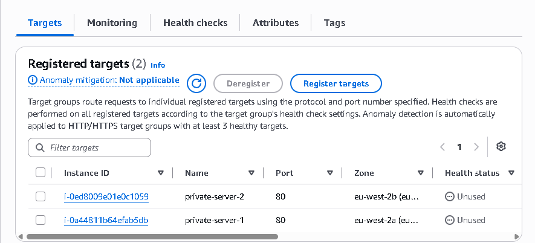
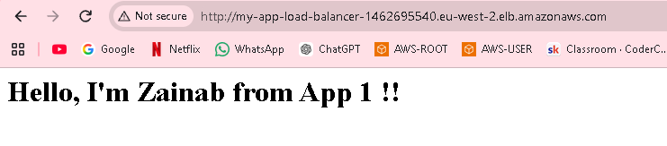
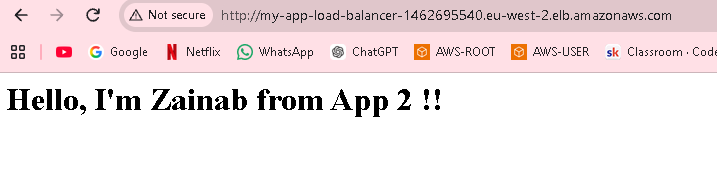
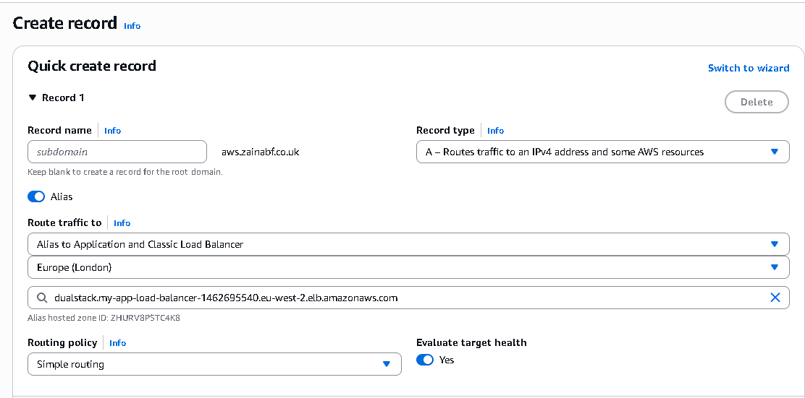
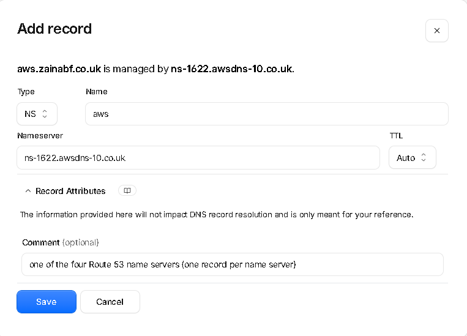
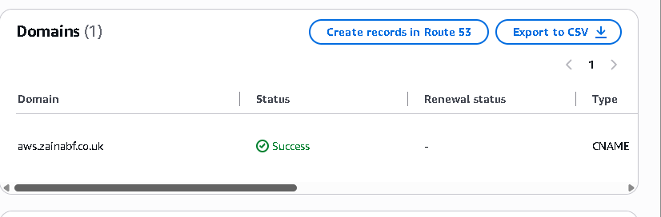
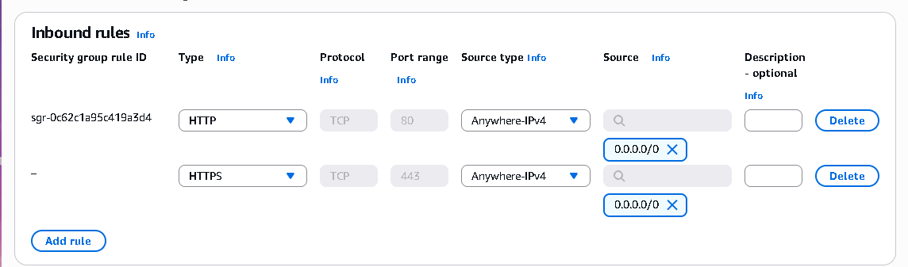
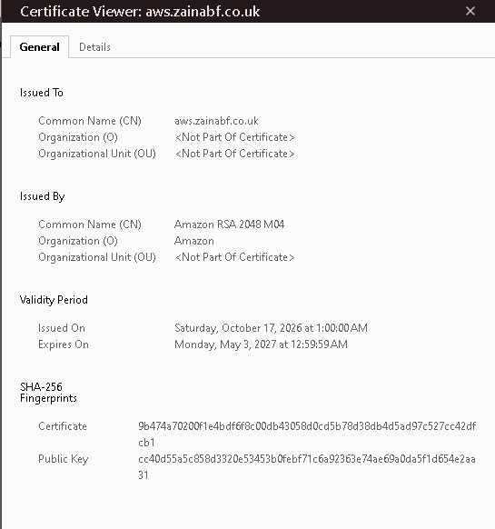

# Assignment 2 - Application Load Balancer

A common DevOps pattern: multiple EC2 instances behind an ALB. This teaches load balancing, health checks, and proper security group isolation.

## Objective

Deploy two EC2 instances behind an ALB. The ALB must handle all incoming traffic. EC2 instances should not be accessible directly from the internet.

1. ALB

BONUS TASKS: 
1. DNS name using route53 - using my own domain on CloudFlare.
2. Adding a HTTPS listener with ACM (Certificate).


## Some Context 

- Private subnets = a subnet whose route table has no route to an internet gateway (it may route outbound traffic through a NAT gateway).

- Private EC2 = any EC2 with no Public IP. 

- AWS says an ALB must be deployed across at least two Availability Zones for high availability, so two public subnets (one per AZ) are required.

- The networking needs to be set up first:
  - Ensure the NAT gateway and private route table are in place before launching the EC2 instances. Otherwise the user data can’t download the web server, and it won’t retry.


## HOW I DEPLOYED AN ALB FOR 2 SERVERS

1. Create a VPC and 2 public and 2 private subnets. 
    - 1 subnet in eu-west-2a. (private) - CIDR 10.0.1.0/24
    - 1 subnet in eu-west-2b (private) - CIDR 10.0.2.0/24
    - 1 public subnet eu-west-2a - CIDR 10.0.3.0/24
    - 1 public subnet eu-west-2b. - CIDR 10.0.4.0/24 

- 2 private subnets = for the private EC2 instances for the load balancer. Each subnet is a different AZ.

- 2 public subnets = an ALB must be deployed across at least two Availability Zones for high availability, so two public subnets (one per AZ) are required.


1. More networking:
   - Internet gateway attached to the VPC.
   - Public route table: 0.0.0.0/0 → IGW, associated with both public subnets
   - NAT gateway in a public subnet (eu-west-2a)
   - Private route table: 0.0.0.0/0 → NAT gateway, associated with both private subnets


3. Create 2 EC2 instances

- Not accessible from the internet - private servers in private subnets pointing to the NAT gateway.  Disable public IP. 
- In the same VPC
- Different AZ's. 
- Install a simple web server using user-data
  
- Add a security group - use the same one for both EC2s. 
  - Add a rule saying HTTP traffic is allowed from the security group of the ALB. 
  - This will be created same time as the ALB so do this after the ALB is created. 
  - No other security group rules are necessary. 


- Each instance should return different content for testing (when using the load balance).


- The script in user data:

```
#!bin/bash

yum update -y 
yum install -y httpd

systemctl start httpd
systemctl enable httpd

echo "<h1>Hello, I'm Zainab from App 1 !! </h1>" > /var/www/html/index.html

```

- Different for 2nd app so we can see the load balancer working. 

```
#!bin/bash

yum update -y 
yum install -y httpd

systemctl start httpd
systemctl enable httpd

echo "<h1>Hello, I'm Zainab from App 2 !! </h1>" > /var/www/html/index.html

```

- Check if the instances have successfully been able to access the internet while still being completely private with no IP addresses: 




4. Setting up the ALB

- Create Application Load Balancer
- Public facing alb. 
- Place it in both of the public subnets.




- Create a new security group for the alb. 
  - Allow HTTP traffic from anywhere. 

- Create a target group.
  - Add the 2 EC2 instances as the targets on the load balancer. 
  - Ensure Health check is configured at root (/).




- Make sure the security group of the EC2 has a rule that allows traffic from the ALB (the security group of the ALB).


1. Check the app is up and running

   - Use URL of the load balancer. 
   - `http://my-app-load-balancer-1462695540.eu-west-2.elb.amazonaws.com/`
  
   - Refreshing the browser will keep switching between the 2 EC2s - should see the text changing from app 1 to app 2. 







**SUCCESS!**


## BONUS

1. Adding a Route53 DNS name and pointing it to the ALB DNS name via ALIAS record type:
   - Create hosted zone - using my own domain:
     - `aws.zainabf.co.uk`

   - Create an Alias record 
   - Route traffic to the Application load balancer I created previously. 




   - Need to add NS servers to cloudflare so AWS can find my domain:
     - Copy the four name servers from the zone’s NS record. They look like ns-123.awsdns-45.com.
     - In Cloudflare: go to your domain → DNS → Records and add four records:
     - Type: NS
     - Name: aws
     - Content: one of the four Route 53 name servers (one record per name server)




- Check the custom domain URL and see the apps being load balanced there instead of the alb url.
- `http://aws.zainabf.co.uk/`


2. Add an HTTPS listener with ACM

- Request a certificate in ACM (AWS Certificate Manager)
  - The certificate must be in the same region as the ALB. 
  - Request a public certificate.
  - DNS validation.
  - Click Create records in Route 53 option - wait till status validated.




- Allow HTTPS into the ALB.
  - Edit the ALB’s security group and add an inbound rule: HTTPS, port 443, from Anywhere (0.0.0.0/0).
  - Leave the EC2 security group alone. The ALB still talks to your servers over plain HTTP inside the VPC, which is normal.




- Add the HTTPS listener
  - Go to EC2 → Load Balancers → your ALB → Listeners tab → Add listener.
  - Protocol: HTTPS, Port: 443
  - Action: Forward to your existing target group
  - Certificate: choose From ACM, then select your aws.zainabf.co.uk certificate


- Now the app will be reachable from https too. Even if you try to visit it on http, it should automatically switch to https.  


- The certificate should be visible: 

