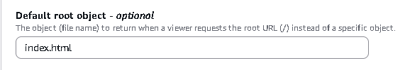
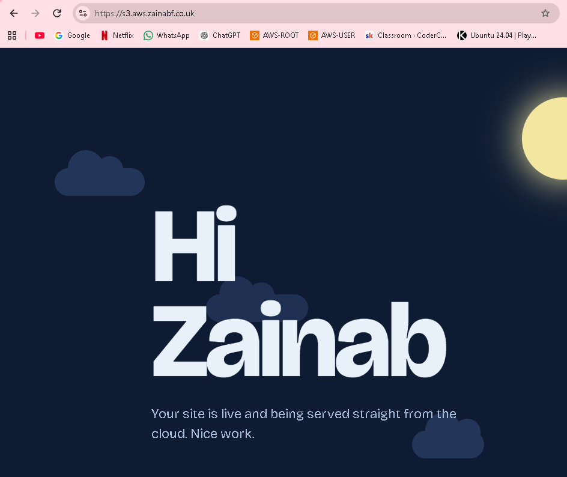
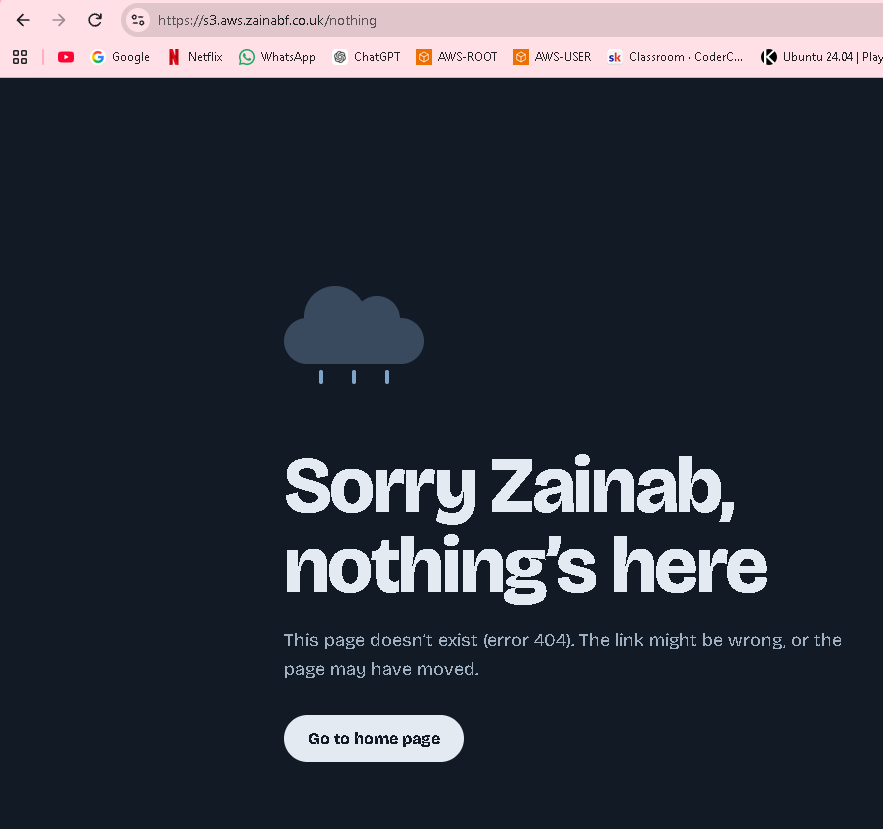
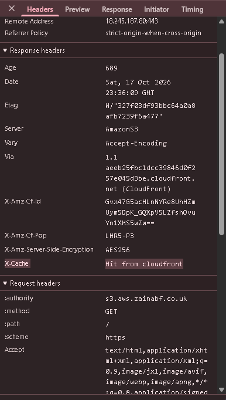

# Assignment 3 - S3 Static Website + CloudFront CDN + Route53 


A core real-world setup that teaches S3 hosting, permissions, caching, HTTPS, and routing.

## Objective

- Create a production-ready static website deployed on:

  - S3 (for hosting)
  - CloudFront (for CDN + HTTPS)
  - Route53 (for the domain)

- This is a classic AWS DevOps workflow.


# HOW I DID THIS:

1. Create an S3 bucket
   - Enable static website hosting. 
   - Upload a simple index.html and error.html (Should be in the same folder as this whole file for documentation).
   - Make sure the block public access section is cleared so that public access is enabled. 

   - Make bucket objects publicly readable (bucket policy). 
     - To make the objects in your bucket publicly readable, you must write a bucket policy that grants everyone s3:GetObject permission.


```json
{
    "Version": "2012-10-17",
    "Statement": [
        {
            "Sid": "PublicReadGetObject",
            "Effect": "Allow",
            "Principal": "*",
            "Action": [
                "s3:GetObject"
            ],
            "Resource": [
                "arn:aws:s3:::my-s3-app-843447001879-eu-west-2-an/*"
            ]
        }
    ]
}

```


2. Set up CloudFront

   - Origin: S3 website endpoint.
   - Enable:
     - HTTPS
     - Compress objects
     - Cache policy (managed - cachingOptimized)
   - Default behaviour - allow GET/HEAD

   - Add an ACM certificate for your chosen domain if using route53. 
     - Already created a hosted zone in route53 for project 2. Using that same domain. 
     - Using `s3.aws.zainabf.co.uk`
     - Check domain.
     - Create a wildcard certificate. 

   - Add error page
     - Go to CloudFront → your distribution → Error pages tab.
     - Click Create custom error response.
     - HTTP error code: 403: Forbidden
     - Customize error response: Yes
     - Response page path: /error.html (with the slash this time)
     - HTTP response code: 404: Not Found
     - Click Create custom error response.
     - Repeat steps -  but choose 404: Not Found as the HTTP error code. This covers both cases.


3. Set up Route53

- Create a hosted zone (I already had one created from before).
- Add an A record (Alias) > point it to CloudFront distribution.


4. Confirm it resolves to the CDN endpoint.
- `https://s3.aws.zainabf.co.uk/index.html`


- It shouldn't need the `index.html` at the end to show the website. 
  - Go to CloudFront → your distribution → General tab → Settings → Edit.
  - Find Default root object and set it to index.html (no slash at the start).



- Now, Cloudfront should know what to display. 




5. Confirm the error page is working
   



6. Confirm CloudFront is serving content:

- Confirm caching:
     - Edit your index.html
     - Invalidate CloudFront cache
     - Refresh page

- This proves that CloudFront is keeping copies of your files at the edge locations, rather than getting them from the origin (s3) everytime. 
- The catch is that if you change the file in S3, CloudFront keeps serving the old copy until it expires (usually 24 hours) or you tell it to throw the copy away. That’s called an invalidation.


- Another way - Use the x-cache response header:

  - Open inspect page in the browser of the app. 
  - `https://s3.aws.zainabf.co.uk`
  - Refresh the page

  - In network tab - response headers
    - x-cache: Miss from cloudfront — CloudFront had to fetch it from S3 (normal on the first visit)
    - x-cache: Hit from cloudfront — CloudFront served its saved copy


    

- Shows that the content was retrieved from the cache. 