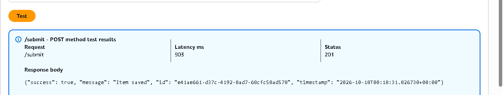
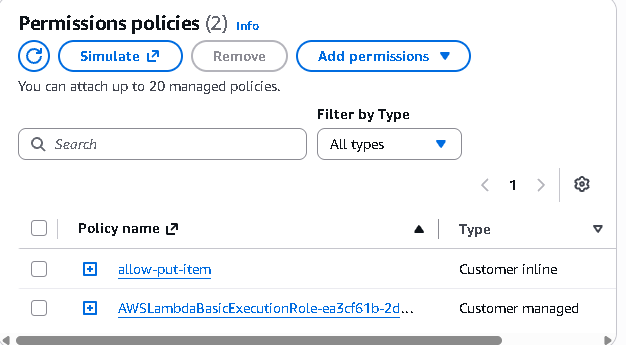

# Assignment 4 - Serverless API with Lambda, IAM, and API Gateway (BONUS)

A hands-on, production-like serverless workflow. This teaches IAM least-privilege, API design, Lambda basics, and debugging.

## Objective

Build a simple REST API using API Gateway → Lambda → DynamoDB.
Your API should accept a POST request, store the data, and return a response.

## Context 

- What is an API?

    - An API is a way for one program to ask another program to do something.

    - You use them constantly without noticing. When a weather app shows today’s forecast, the app isn’t working out the weather itself. It sends a request to a weather company’s API (“what’s the weather in London?”) and gets the answer back.

    - So an API is like a front counter: you hand over a request, something happens behind the scenes, and you get a reply.


- Why this matters in real life

  - Imagine a signup form on an S3 website. When someone types their name and clicks Submit, the page sends that data to the API, and it gets saved in DynamoDB. That’s this exact project.


- THE WORKFLOW:

- When you click Send in Postman:

  - Postman sends Mo’s details to your web address ending in /submit.
  - API Gateway receives it at the counter and hands it to Lambda.
  - Lambda runs your code, which:
      - writes “Received event” in the CloudWatch diary
      - creates a unique ID (like an order number)
      - adds the current time
      - stores ID, time and Zainab's details in DynamoDB, using its IAM key
      - writes “Saved item” in the diary
  - Lambda sends back a receipt: “success, here’s your ID”.
  - API Gateway passes that receipt back to Postman, and you see it on screen.
  - POST: the type of request. POST means “here’s some data, please save it”. (GET, the other common type, means “give me some data”.)
  
That’s all the project does: receive some data from the internet and save it in a database.


## THE ACTUAL PROJECT:

1. Create a DynamoDB Table

- Table name: students
- Partition key: id (string)
- Provisioning: On-demand capacity mode


2. Create the Lambda Function

- Runtime: Python 3.12
- Permissions:
  - Allow PutItem on the DynamoDB table
Create function.

- Logic (you can use AI to write the code, no probz here):
  - Generate a UUID
  - Store { id, timestamp, payload }
  - Return a structured JSON response

```py
import json
import os
import uuid
import logging
from datetime import datetime, timezone

import boto3
from botocore.exceptions import ClientError

# Logging: anything logged here appears in CloudWatch Logs
logger = logging.getLogger()
logger.setLevel(logging.INFO)

# The table name comes from an environment variable called TABLE_NAME
TABLE_NAME = os.environ.get("TABLE_NAME")
table = boto3.resource("dynamodb").Table(TABLE_NAME)


def respond(status_code, body):
    """Build a structured JSON response."""
    return {
        "statusCode": status_code,
        "headers": {"Content-Type": "application/json", "Access-Control-Allow-Origin": "*"},
        "body": json.dumps(body),
    }


def lambda_handler(event, context):
    logger.info("Received event: %s", json.dumps(event))

    # 1. Read the payload
    #    From API Gateway it arrives as text in "body"; from a console test it's the event itself.
    try:
        if "body" in event:
            payload = json.loads(event["body"]) if event["body"] else {}
        else:
            payload = event
    except (json.JSONDecodeError, TypeError):
        logger.warning("Request body was not valid JSON")
        return respond(400, {"success": False, "error": "Request body must be valid JSON"})

    if not payload:
        logger.warning("Empty payload received")
        return respond(400, {"success": False, "error": "Payload cannot be empty"})

    # 2. Build the item: a unique ID, the current time, and the payload
    item = {
        "id": str(uuid.uuid4()),
        "timestamp": datetime.now(timezone.utc).isoformat(),
        "payload": payload,
    }

    # 3. Save it to DynamoDB
    try:
        table.put_item(Item=item)
    except ClientError as error:
        logger.error("DynamoDB error: %s", error.response["Error"]["Message"])
        return respond(500, {"success": False, "error": "Could not save the item"})
    except Exception as error:
        logger.exception("Unexpected error: %s", error)
        return respond(500, {"success": False, "error": "Something went wrong"})

    logger.info("Saved item with id %s", item["id"])

    # 4. Return a structured JSON response
    return respond(201, {
        "success": True,
        "message": "Item saved",
        "id": item["id"],
        "timestamp": item["timestamp"],
    })

```
- Click deploy. 

3. Tell it which table to use
  - Go to Configuration → Environment variables → Edit → Add:
  - Key: TABLE_NAME
  - Value: your DynamoDB table’s exact name - students.
  - The code expects the table’s partition key to be called id (type String).

4. Allow PutItem on the table
   - Go to Configuration → Permissions and click the role name, which opens IAM.
   - Add permissions → Create inline policy.
   - Service: DynamoDB. Action: PutItem only.
   - Resources: Specific → add your table’s ARN (copy it from the table’s Overview tab in DynamoDB).
   - Name the policy (e.g. allow-putitem) and create it.
   - Giving only PutItem on only that table is called least privilege.


5. Test it
   - In the Test tab, create a test event with something like:

```json

{ "name": "Zainab", "message": "hello" }

```

   - Click Test. You should get "success": true with an ID. Then check:
     - DynamoDB → your table → Explore items: the new item should be there.
     - Monitor → View CloudWatch logs: you’ll see the “Received event” and “Saved item” messages.

- To test the error handling, try a test event of {}. You should get a 400 error saying the payload can’t be empty.

```json
{
  "statusCode": 400,
  "headers": {
    "Content-Type": "application/json"
  },
  "body": "{\"success\": false, \"error\": \"Payload cannot be empty\"}"
}
```


6. Build the API Gateway REST API


- Create the API
  - Go to API Gateway → Create API.
  - REST API
  - Choose New API, give it a name (e.g. students-api), keep endpoint type Regional, and click Create API.

- Create the /submit resource
  - Click Create resource.
  - Resource name: submit
  - Tick CORS (Cross Origin Resource Sharing). This sets up the part browsers check before sending data.
  - Click Create resource.


- Add the POST method
  - With /submit selected, click Create method.
  - Method type: POST
  - Integration type: Lambda function
  - Switch Lambda proxy integration on. This passes the whole request straight to your function, which is what your code expects.
  - Choose your region (eu-west-2) and select the previously created function.
  - Click Create method. AWS automatically gives API Gateway permission to call the Lambda function.

- Enable CORS
  - Select /submit, then click Enable CORS.
  - Tick POST and OPTIONS.


- Deploy the API
  - Click Deploy API.
  - Stage: New stage, name it prod, and click Deploy.
  - Copy the Invoke URL shown at the top. The endpoint is that URL with /submit on the end, for example:
https://abc123.execute-api.eu-west-2.amazonaws.com/prod/submit

- Any time I change the API later (not the Lambda), I need to Deploy API again for the changes to go live.

- Test it
  - The easiest test, without code: go to Resources → POST under /submit → Test tab. In Request body, paste:

```json
{ "name": "Zainab", "message": "hello from API Gateway" }
```



- Should also see a new item in dynamodb table.


## IAM PERMISSIONS FOR LAMDBA:

- Allows write access to DynamoDB.
- Has basic Lambda permissions. 
- No over-permissive permissions. 
  



## TESTING


- Testing

  - Postman (easiest without code)
  - Download and open Postman, then click New → HTTP.
  - Change GET to POST and paste the endpoint URL (the one ending in /prod/submit).
  - Go to Body → raw, and change the dropdown on the right from Text to JSON.

```json
   {
     "name": "Zainab",
     "module": "AWS"
   }
```

- Click Send. Should see status 201 Created and a response with "success": true and an ID. 
