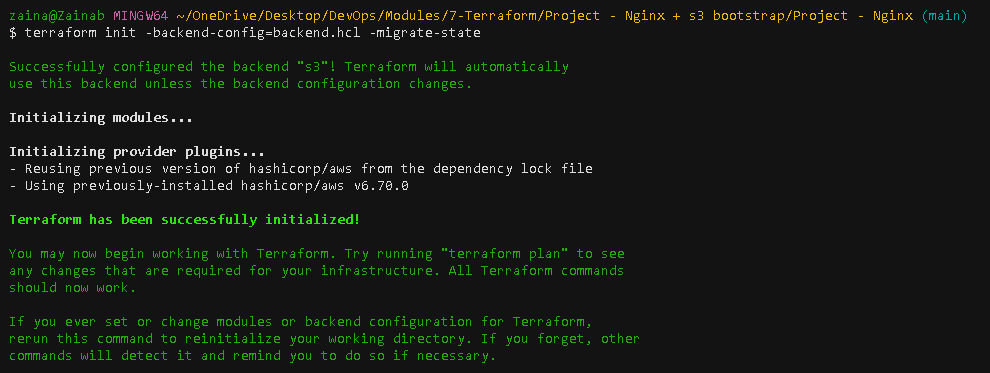
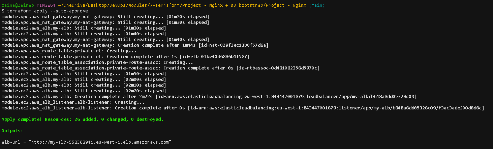
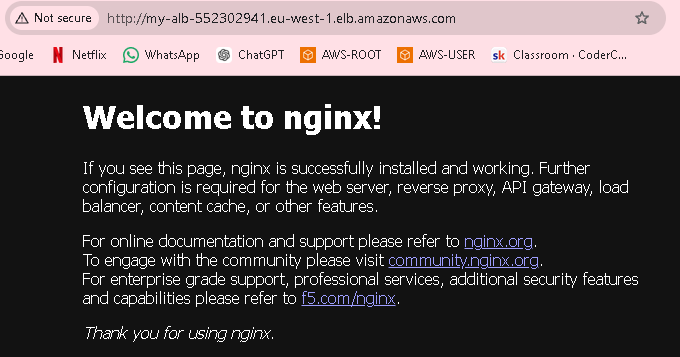

# Assignment 2 – EC2 Deployment with Cloud-Init

## Objective

- Configure a cloud-init file and use Terraform to automate an EC2 deployment.

- The task:
  - Write a cloud-init YAML file
  - Install and configure software on boot (e.g. NGINX or Apache)
  - Pass cloud-init to the EC2 instance through Terraform
  - Ensure the instance comes online fully configured with no manual steps


# How I completed this:

## Cloud-init in a nutshell:

- What it is: a program already installed on most cloud servers (including AWS) that sets the server up automatically.
- When it runs: only the first time a new server starts. Changing the instructions later means Terraform has to build a new server.
- How it gets instructions: you write them, and Terraform passes them to the server through user_data.
- What format the instructions can be:
  - a cloud-init YAML file (starts with #cloud-config), a checklist of what you want, like “install NGINX, then start it”
  - or a normal bash script (starts with #!/bin/bash), step-by-step commands
- Why YAML exists: it’s simpler and easier to read for common jobs (installing software, creating users, writing files), and it works across different types of Linux without changes.
- The goal: the server comes online fully set up, with no logging in and no manual steps.


## Project Structure:

```
7-Terraform/
├── bootstrap/                   # Run once: creates the S3 bucket for remote state
│   ├── main.tf                  # S3 bucket, versioning, public access block
│   ├── variables.tf             # Region and bucket name
│   └── outputs.tf               # Bucket name
│
└── Project - Nginx/
    ├── main.tf                  # Calls the modules and connects them
    ├── provider.tf              # AWS provider and S3 backend (state stored in the bootstrap bucket)
    ├── variables.tf             # Root values (region, CIDRs, AMI, instance type)
    ├── outputs.tf               # Shows the ALB URL after apply
    ├── .terraform.lock.hcl      # Locks provider versions
    ├── .gitignore
    ├── README.md
    ├── images/                  # Screenshots for the README
    └── modules/
        ├── networking/
        │   ├── main.tf          # VPC, subnets, gateways, route tables
        │   ├── variables.tf
        │   └── outputs.tf       # VPC ID and subnet IDs for the app module
        │
        ├── app/
        │   ├── main.tf          # EC2, ALB, listener, target group, security groups, user data
        │   ├── variables.tf
        │   └── outputs.tf       # ALB DNS name
        │
        └── iam/
            ├── main.tf          # IAM role for Session Manager
            ├── variables.tf
            └── outputs.tf       # Instance profile name for the app module
```


## Features:

1. S3 Remote backend configured:
   - Local boostrap - This is to create the s3 bucket before the remote backend can be configured.
     - It's an initial core solution that runs locally.
     - It provisions the resources terraform requires for remote state management.
  
   - Terraform’s state (its record of what it built) should be stored online so it’s safe and shareable. But the storage itself (an S3 bucket) has to be created first, and you want Terraform to create it. So it's done in two phases:

   1. Bootstrap: a small “core” project creates the S3 bucket, storing its own state on local computer for now.
   2. Move in: tell the core project to move its state into the bucket it just made. From then on, all your projects store their state there.

   HOW I DID IT:

   1. Created a new folder called bootstrap - Includes creation of s3 bucket for the backend. It also creates a file called backend.hcl which is created in my nginx project folder because that's where I need the backend configured.

   - The backend.hcl file: Can also create yourself. 
   ```
   bucket       = "your-bucket-name"
   key          = "nginx/terraform.tfstate"
   region       = "us-east-1"
   use_lockfile = true

   ```
   
   2.  Run the bootstrap file. 
   ```
   cd bootstrap
   terraform init
   terraform apply
   ```

   3. Tell my project to use that s3 bucket - Provider file:
   
   ```
   terraform {
      backend "s3" {}
   }

   ```

   4. Move my state over to the s3 bucket:

   ```
   cd "../Project - Nginx"
   terraform init -backend-config=backend.hcl -migrate-state

   terraform plan # should show no changes
   ```




2. IAM role for Session Manager
   - Lets you connect to the EC2 instance from the AWS console without SSH: no public IP, no port 22 and no key pair needed.
   - the instance still needs outbound internet access, through a NAT gateway.


3. Completely Private application 
   - The nginx app sits inside a private subnet. 
   - Reaches internet through NAT gatway (lives in the public subnet).
   - Traffic reaches server through ALB. 
   - Accessible through Session Manager. 


4. Cloud-init yaml file:

### Bash to cloud-init

| Bash script | cloud-init | What it does |
|---|---|---|
| `#!/bin/bash` | `#cloud-config` | Tells the server what kind of instructions these are |
| `yum update -y` | `package_update: true` | Refreshes the list of available software |
| `yum upgrade -y` | `package_upgrade: true` | Upgrades software that's already installed |
| `yum install nginx -y` | `packages:` `- nginx` | Installs NGINX |
| `systemctl start nginx` / `systemctl enable nginx` | `runcmd:` | Runs these commands at the end |
| `echo "Script Complete"` | `final_message:` | Prints a message to the log when everything's done |


## APPLICATION WORKS:







## Troubleshooting: AWS credentials error

**Error:** `terraform plan` failed with `InvalidClientTokenId: The security token included in the request is invalid.`

**Cause:**
- The old AWS access key had been deleted in the AWS console, so AWS rejected it.
- The old key was also loaded as environment variables in the terminal (`AWS_ACCESS_KEY_ID`, `AWS_SECRET_ACCESS_KEY`). Environment variables take priority over `aws configure`, so new keys weren't being used.

**Fix:**
1. Created a new access key in the AWS console (IAM → Users → Security credentials).
2. Cleared the old keys from the terminal:
   ```bash
   unset AWS_ACCESS_KEY_ID AWS_SECRET_ACCESS_KEY AWS_SESSION_TOKEN
   ```
3. Saved the new keys with `aws configure`.
4. Confirmed with `aws sts get-caller-identity`.

**Lessons:**
- Run `env | grep AWS_` if `aws configure` seems to have no effect.
- In `aws configure`, pressing Enter keeps the existing values shown in [brackets].
- Never commit access keys to the repo.