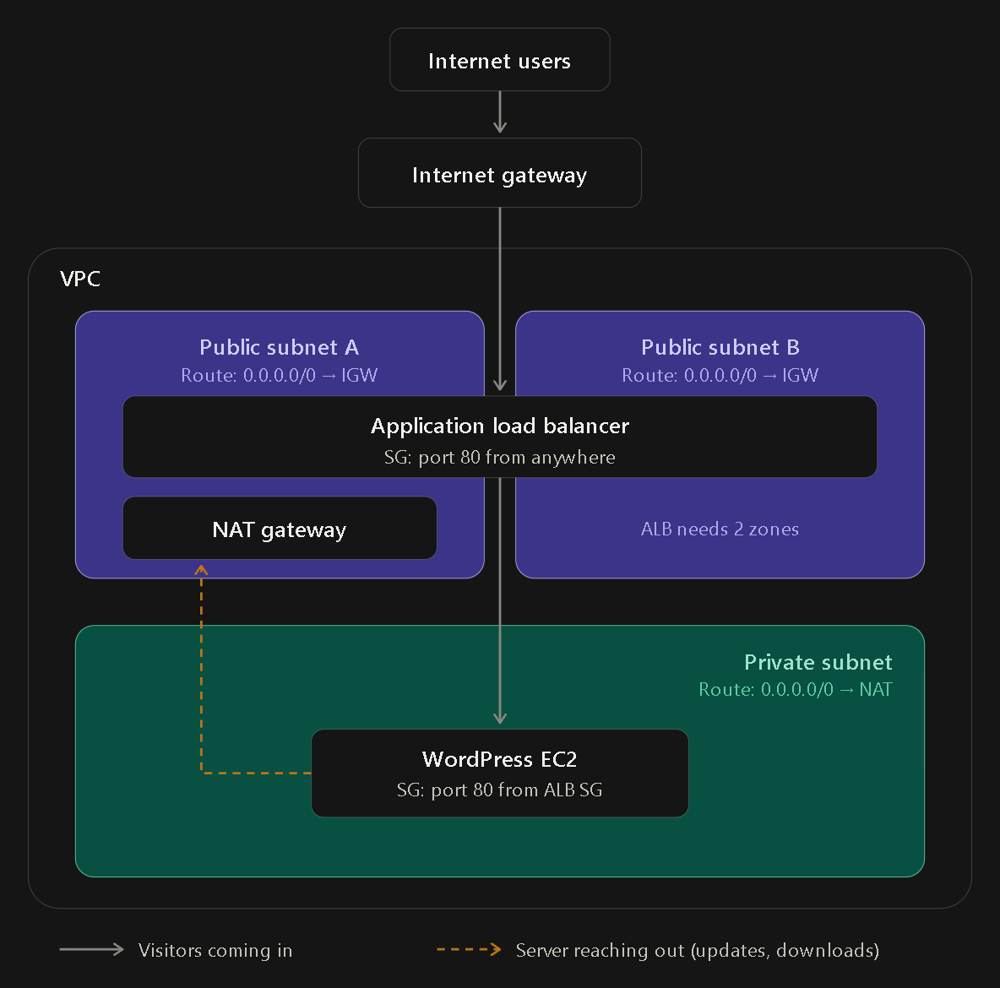
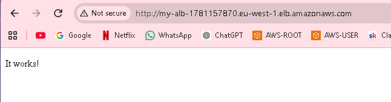
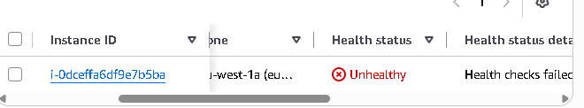
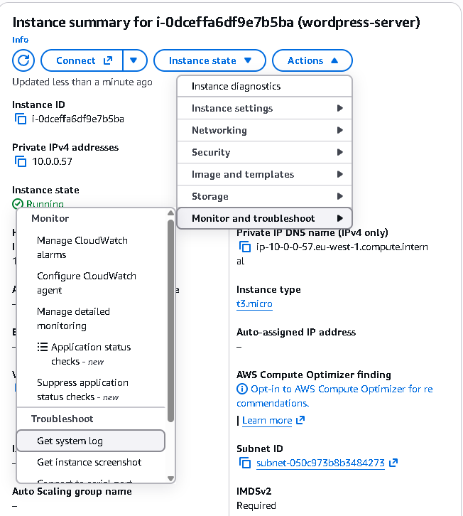
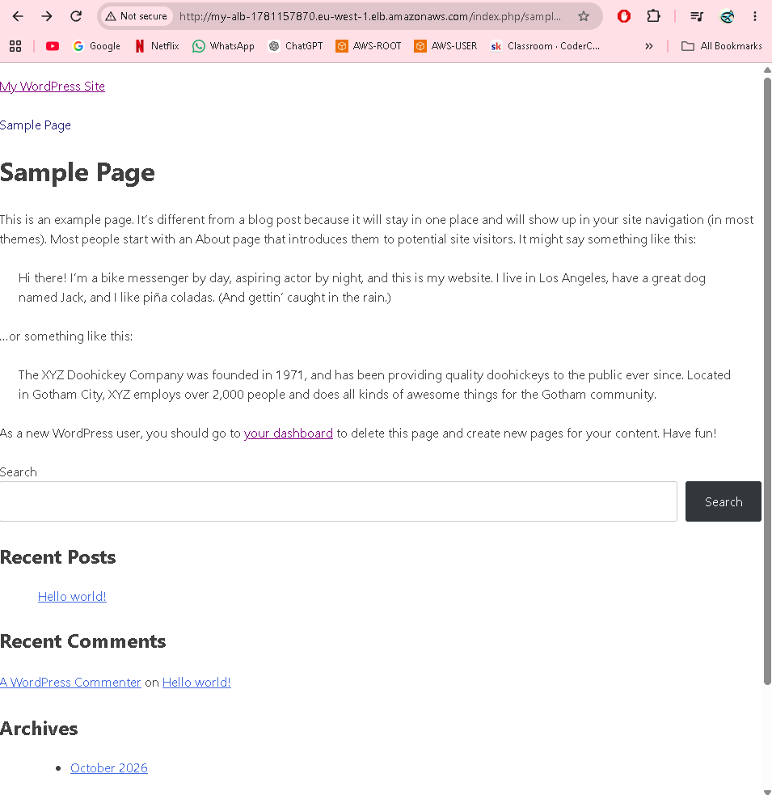
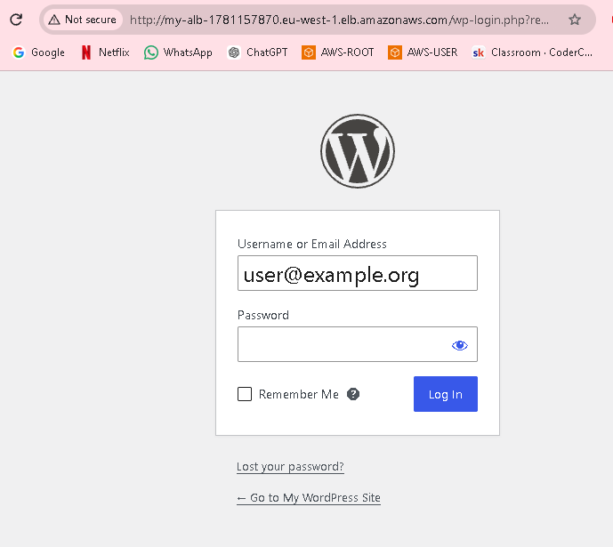
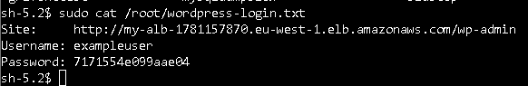
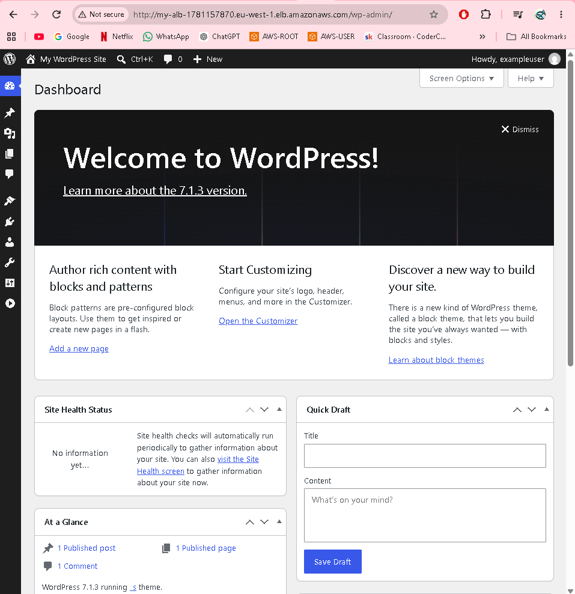
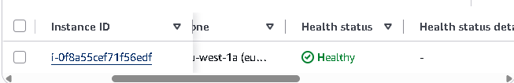

# Assignment 1 – Deploy WordPress Using Terraform

## Objective

- Use Terraform to deploy a full WordPress stack on AWS.

- Your setup should include:
  - EC2 instance running WordPress
  - Security groups
  - User data or cloud-init to install dependencies
  - A working public endpoint
  - All resources provisioned via Terraform

This assignment shows you how Terraform manages real infrastructure end-to-end.

## NOTE

- EC2 INSTANCE HAS `user_data_replace_on_change = true`
- This makes EC2 instance get recreated everytime there's a change in userdata. 

# Overview of my Infrastructure:



2 Terraform Modules: 

   - **App module** - Containing the EC2 instance along with it's security groups and ALB. 
     - Security group - allows http/https traffic from ALB's Security group.
     - ALB - With 2 public subnets
       - Security group allows all http/https traffic from anywhere.
  
     - `iam.tf` --> grants the EC2 permission to use AWS Systems Manager (Session Manager), so I can open a terminal on it from the AWS console without SSH, keys, open ports or a public IP.
        - **IAM role** (`ec2-ssm-role`) - can only be used by EC2 instances.
        - **Policy** (`AmazonSSMManagedInstanceCore`) - AWS's ready-made permissions for Session Manager: lets the EC2 check in with Systems Manager, open terminal sessions, and receive commands. It can't touch any other AWS resources (least privilege).
        - **Instance profile** (`ec2-ssm-profile`) - the wrapper that attaches the role to the EC2, via `iam_instance_profile` in `ec2.tf`.
        
   - **Networking module** - Setting up the underlying network infrastructure. 
     - VPC
     - Subnets (2 public for the ALB, 1 private for EC2)
     - Internet Gateway (inbound internet traffic for ALB)
     - NAT Gateway (EC2 access to the internet for downloads/updates) in public stubnet
     - Route tables 
        - Public route table (for the 2 public subnets): send all internet-bound traffic to the Internet Gateway.
        - Private route table (for the EC2 subnet): send all internet-bound traffic to the NAT Gateway.


## APACHE PAGE WORKING - APP DOESN'T WORK YET - ERROR WALKTHROUGH

- This is Apache's default page - placeholder. 
  


- The catch is that Apache sends that page with an error code (403), meaning “nothing here.” Your browser displays the page anyway, but the ALB’s health check sees the error code and marks the EC2 as unhealthy.
  



**TROUBLSHOOTING WHY APP ISN'T LOADING:**

- Go to system logs. 
- Shows what happened in the server when the userdata ran



- Showed PHP Error --> `PHP Fatal error: Allowed memory size of 134217728 bytes exhausted`

- FIX = Give PHP more memory. 

```
    # ---- Give PHP more memory ----
    sed -i 's/^memory_limit = .*/memory_limit = 512M/' /etc/php.ini
```

## **APP RUNNING!**

- Press dashboard
  




Login to the app:
  - In EC2 instance: accessed through SSM in browser:
  - IAM permissions need to be set up through terraform for this (iam.tf).
    - Shows the credentials for wordpress app:
    - `sudo cat /root/wordpress-login.txt`
  


- THE APP WORKS!




- The target group is also healthy (the app ec2)




## Issues encountered and fixes

**1. Passing the whole VPC instead of its ID**
- *Error:* `Inappropriate value for attribute "vpc_id": string required, but have object.`
- *Cause:* The networking module's output returned the whole VPC resource (`aws_vpc.main`) instead of just its ID.
- *Fix:* Added `.id` to the outputs in `modules/networking/outputs.tf` (e.g. `aws_vpc.main.id`).

**2. Subnets outside the VPC's IP range**
- *Error:* `InvalidSubnet.Range: The CIDR '10.0.1.0/26' is invalid.`
- *Cause:* The VPC was `10.0.0.0/24`, which only covers `10.0.0.x`, so subnets starting `10.0.1` and `10.0.2` didn't fit inside it.
- *Fix:* Changed the VPC CIDR to `10.0.0.0/16`, giving room for all subnets.

**3. Resources created in different regions**
- *Error:* `InvalidVpcID.NotFound` / `InvalidSubnetID.NotFound`, even though the VPC was created.
- *Cause:* Some resources had their own `region` argument, so the VPC and subnets were built in a different region from everything else.
- *Fix:* Removed `region` from all resources and set it only once in the AWS provider (`region = var.region`).

**4. Security group ingress syntax**
- *Cause:* Wrote `ingress = [aws_security_group.alb-sg]`, but ingress is a block with ports and a source, not a list of resources.
- *Fix:* Used an `ingress { ... }` block with `security_groups = [aws_security_group.alb-sg.id]` to allow traffic only from the ALB.

**5. ALB subnets in the same Availability Zone**
- *Error:* `A load balancer cannot be attached to multiple subnets in the same Availability Zone.`
- *Cause:* No `availability_zone` was set on the public subnets, so AWS placed both in the same zone. An ALB needs subnets in at least two different zones.
- *Fix:* Set `availability_zone` on each public subnet so they sit in two different zones within the same region (e.g. `eu-west-2a` and `eu-west-2b`).

**6. AMI not found**
- *Error:* `InvalidAMIID.NotFound: The image id '[ami-...]' does not exist.`
- *Cause:* AMI IDs are different in every region. The ID was copied from the console while it was set to a different region from Terraform.
- *Fix:* Used the AMI ID for the correct region. Future improvement: look it up automatically with `data "aws_ssm_parameter"`, so it works in any region.

**7. NAT Gateway can't find its Elastic IP**
- *Error:* `InvalidElasticIpID.NotFound: The elasticIp ID '...' does not exist.`
- *Cause:* Another symptom of the region mismatch in issue 3: the Elastic IP and NAT Gateway were being created in different regions.
- *Fix:* Made sure `region` is set only in the provider, so every resource is created in the same region.

**8. EC2 Instance Type Not Free Tier Eligible**
- *Error:* 
- *Cause:* The tier `t2.micro` wasn't free tier eligible in the region I was using. 
- *Fix:* Queried the free-tier-eligible instance types and changed my variable to that. 

  `aws ec2 describe-instance-types --filters Name=free-tier-eligible,Values=true --query “InstanceTypes[*].InstanceType” --output text --region eu-west-1`


## Lessons learned
- Each module has its own `variables.tf` (inputs) and `outputs.tf` (outputs); the root `main.tf` connects them.
- Modules can't reference each other directly; values pass through the root using `module.<name>.<output>`.
- `depends_on` is rarely needed, because Terraform works out the order from references.
- An Application Load Balancer can't have an Elastic IP (only a Network Load Balancer can).
- Set the region in one place (the provider). Region mismatches show up as confusing "does not exist" errors.
- A subnet's CIDR must fit inside the VPC's CIDR. A smaller number after the `/` means a bigger range.
- AMI IDs are per region, and load balancers need subnets in at least two Availability Zones.


<!-- - DNS Setup: ADVANCED

  - Custom domain: zainabf.co.uk
  - ALB's don't have fixed IP addresses. So, use their permenant DNS name. 
  - Use AWS Route53 and create a hosted zone and an alias record. 
  - Point domain at the ALB domain name.  -->


