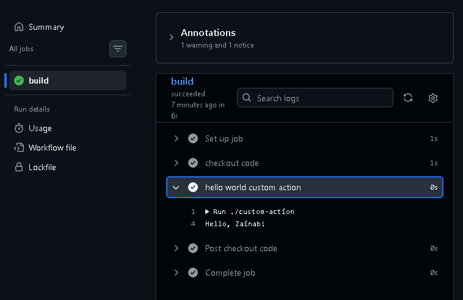

# Creating custom actions

- Reusable units of code that automate tasks in CICD pipeline.
- Consistency and efficiency. 

## Basic overview:

- Create a custom action file (action.yaml).
- Create the app files (index.js, dist folder)
- Run some commands for java dependencies
- Create the workflow file - custom.yaml - and place it in .github/workflow folder. This is so github actions recognises it as a workflow file. 


## Creating a custom action
  1. Create a new repository for the action.

  2. Define the action metadata in an action.yml file:


```yml
name: Zainab Custom Action

description: Greet someone

inputs: # Takes input from user
  Who-to-greet:
    description: Who to greet
    required: true
    default: Hello # if no input


runs: 
  using: node20
  main: dist/index.js # Specific to java 

```

  3. Write the code for your action - in index.js file.
    - java = npm and index.js
    - Create a dist folder - specific to creating custom actions on java. Leave it empty for now
    - `npm init -y` in the project folder (/c/Users/zaina/OneDrive/Desktop/cicd/cicd/custom-action) to install package.json.
    - Install dependencies `npm install @actions/core --save`
    - index.js = code file with app.
    - `npm i -g @vercel/ncc`
    - `npm install @actions/core@1.11.1`
    - `ncc build index.js --license licenses.txt` - This pushes the index.js file to the dist folder. And licenses file. 

- Index.js file: App

```js
const core = require('@actions/core')

try {
    const nameToGreet = core.getInput('who-to-greet');
    console.log(`Hello, ${nameToGreet}!`);
    core.setOutput('time', new Date().toDateString());
} catch (error) {
    core.setFailed(error.message);
}

```


  4. Create .gitignore file in the project folder with these contents: 

  ```
  *node_modules
  ```


  5. Push this all to github 
    - git add .
    - git commit -m 
    - git push


  6. Create the actual workflow file:

  ```
  name: Zainab Custom Action CI

  on: [push]

  jobs:
    build:
      runs-on: ubuntu-latest

      steps:
      - name: checkout code
        uses: actions/checkout@v4

     - name: hello world custom action
        uses: ./custom-action # To point to a folder in your own repo, you start the path with ./
        with:
          who-to-greet: 'Zainab'

  ```

  - Push to github - check github actions tab for the pipeline running.

  7. Publish the action to Github marketplace (optional).


Pipeline works:




## Using a custom action in a pipeline: 


```yml

- name: Custom action step
  uses: owner/repo@v1
  With: 
     some-input: 'value'

```

- E.g. : 


```yml

- name: Use Hello world action
  uses: zainabx1/custom-action@main
  With: 
     who-to-greet: 'Zainab'

```