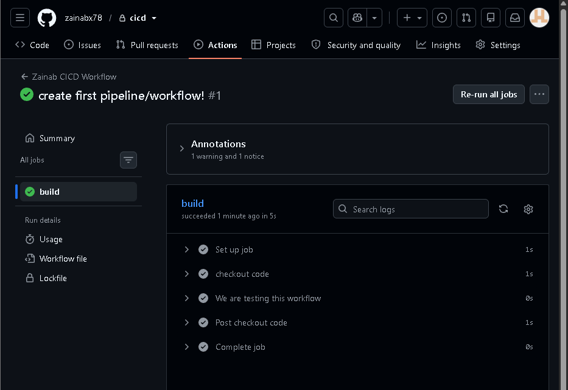

# Pipelines - Called workflows in Github Actions. 


## Structure: 

```
name: Zainab CICD Workflow
on: [push]

jobs:
  build:
    runs-on: ubuntu-latest
    steps:
      - name: Checkout code
        uses: actions/checkout@v2
      - name: Set up Node.js
        uses: actions/setup-node@v2
        with:
          node-version: '14'
      - name: Install dependencies
        run: npm install
      - name: Run tests
        run: npm test

```

- Name = the name of my workflow/pipeline. 
- `on: [push]` = Trigger is on push --> everytime there's a git push, the pipeline will run.

- jobs = series of tasks that run. 
  - Each job runs in it's own virtual environment. 
  - In this workflow, there's a single job called build. 
  - `runs-on` = which OS to use for the job. 

- `steps` = jobs are composed of steps. 
  - Individual commands or actions within a job. 

  - The first step `checkout code` takes the latest code from your repo so that the next steps can work with it. 

  - Steps run in order. 


## Build a Sample CI Pipeline 

1. Set up repository - github.
   - Create a new repo and clone it using ssh link to your local computer. Created a new local folder for this too (cicd in desktop).
   - Create a folder in that called `.github/workflows`.
   - Add the `ci.yaml` file within that folder. 
   - This is the workflow file.


2. Create the workflow file
   - For GitHub to find it, save this file inside your project at .github/workflows/, for example as .github/workflows/ci.yml.

```yml

name: Zainab CICD Workflow

on: [push]

jobs: 
  build:
    runs-on: ubuntu-latest
    steps:
    - name: checkout code
      uses: actions/checkout@v2 # This action already exists - provided by github
    - name: We are testing this workflow
      run: echo Hello everyone!


```


3. Push to github

- `git add .`
- `git commit -m "first pipeline/workflow!"`
- `git push`

4. Check github for the pipeline running: 
   - Actions tab at the top




## Creating a pipeline with matrix builds (multiple versions in 1 pipeline)


### CREATING THE PIPELINE: 

  1. Need to create the application file and the test file:

  - File = `hello,py` = application file

  ```py
  def say_hello():
    return "Hello World!"

  if __name__ == "__main__":
    print (say_hello())

  ```


  - Test file: 

  ```py
  import unittest 

  from hello import say_hello

  class TestHello(unittest.TestCase):
    def test_say_hello(self):
        self.assertEqual(say_hello(), "Hello World!")

  ```

  2. Creating the actual pipeline
   - Needs to be in the .github/workflows folder!


```py

name: Zainab Combined # Workflow / pipeline name

on: [push] # On the condition of a git push


jobs:     # Creating a job and build running on ubuntu
  build:
    runs-on: ubuntu-latest

    strategy:     # This is how to run the same pipeline on multiple versions.
      matrix:     # Using matrix 
        python-version: ["3.8", "3.9", "3.10"]  # Loops over these versions for the pipeline.


    steps: 

    - name: checkout code  # Step 1 - download code on to the borrowed vm. 
      uses: actions/checkout@v4


    - name: setup python   # Step 2 - installs python. 
      uses: actions/setup-python@v5
      with: 
        python-version: ${{matrix.python-version}} # Uses the version from the loop above


    - name: install_dependencies  # step 3 - install extra dependencies
      run: |
        cd python
        python -m pip install --upgrade pip
        if [ -f requirements.txt ]; then pip install -r requirements.txt; fi

    - name: run tests # Step 4 - go into python folder and run tests.
      run: |
        cd python
        python -m unittest discover 


    - name: notify us of success # Step 5: if everything before this worked, print a message saying the tests passed on that Python version.
      run: echo "Tests passed on python ${{matrix.python-version}}"
      if: success()

```
