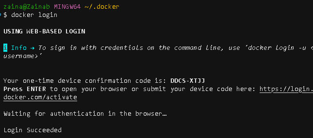
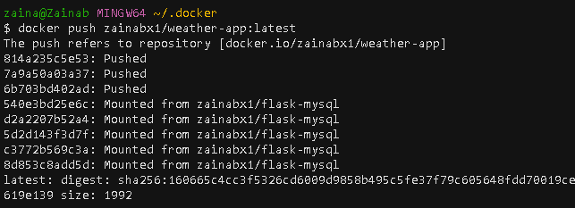
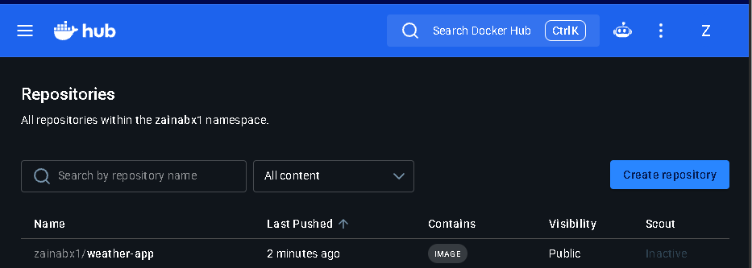
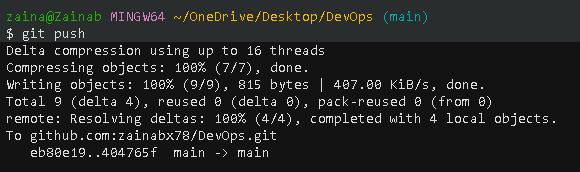
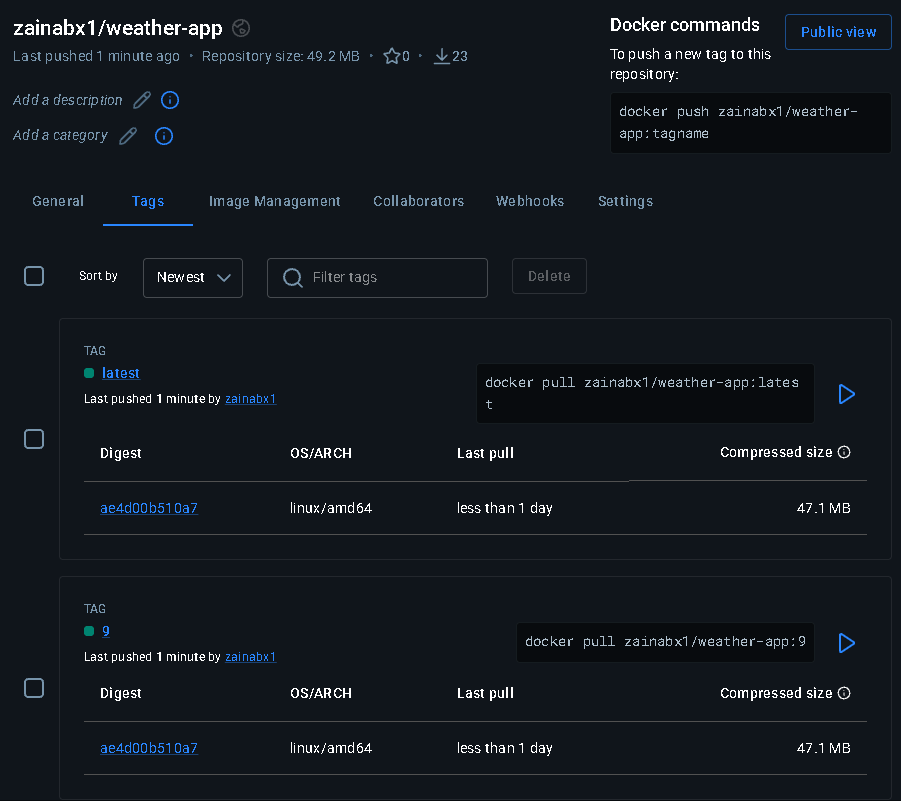

# Setup a pipeline which builds and pushes your container image to DockerHub (Container registry)

- Did everything manually first to understand the steps and commands involved.
- Then created a pipeline/workflow file to automate it. 


## Ensuring the docker container actually runs
## Also using multistage builds to optimise the size of image 
### Manually 


1. Get the app file - app.py
   - Using a weather app that I can query and it returns the weather. 
   - Put that code into an app.py file. 
  

3. Create a requirements.txt file
    - The requirements file is a shopping list of those add-ons. When I run pip install -r requirements.txt, pip reads the list and installs everything on it. 
    - Without the list, I'd have to remember and install each add-on myself.

    - Python comes with a set of built-in tools, but this app uses two add-ons that don’t come with it. 
      - `Flask`lets Python act like a small website and answer your browser. 
      - `Requests` is what the app uses to talk to the weather service.

4. Run the app locally to find the entry point. 
    - Each dockerfile needs to know entrypoint.
    - Since this app is just a python app, I have to use `python app.py` to run this app locally. 


5. Create a docker file for the application

```dockerfile

# Stage 1: Build stage

FROM python:3.8-slim as Build

# Create a folder called /app and go into it. Everything after this happens inside that folder
WORKDIR /app

# Install everything on the shopping list. --no-cache-dir throws away leftover download files to keep things small. 
COPY requirements.txt .
RUN pip install --no-cache-dir --prefix=/install -r requirements.txt

# Copy the rest of your project (like app.py) into /app.
COPY . .


# Stage 2 - Production stage

FROM python:3.8-slim 

WORKDIR /app

# Reach back into the “build” stage and grab the installed packages from /install. 
# Put them in /usr/local, which is where Python automatically looks for packages.
COPY --from=build /install /usr/local
COPY --from=build /app /app

# Create a normal, limited user called appuser
RUN useradd appuser

# Switch to that user, so the app doesn’t run as root (the all-powerful admin). 
# Safer if someone breaks in.
USER appuser

EXPOSE 5000

CMD ["python", "app.py"]

```


6. Create a docker image from the dockerfile. 
    - `docker build -t weather-app .`
      - This builds a docker image.
      - `-t` = tag
      - `.` at the end means build a docker image from the current folder dockerfile. 
      - `docker images` - shows the created image in the list

    - Keeping the size small: 
      - Using multistage builds so that the image is lightweight.
      - `docker images`

    


7. Run the container using that image: 

    - `docker run -d --name weather-app -p 5000:5000 -t weather-app:latest`
      - `-d` means detached mode - keeps running in the background.

CONTAINER RUNS!


## Pushing image to Dockerhub - Manually 

- Create a repository in Dockerhub first
  - name: weather-app
  - public
- In terminal - 
- `docker login` 
  - This might fail: 
  - Login error command to do with credentials. 
  - Need to get rid of the config file that holds the credentials for docker so it can create a new config file. 
  - `rm ~/.docker/config-old.json` 
  - Then run `docker login` again. 

  

- `docker build -t zainabx1/weather-app:latest .`
- `docker push zainabx1/weather-app:latest`

  


- Should see the image in Dockerhub:

  


## Pushing the image to DockerHub via Github Actions workflow (pipeline)


1. Create a `.github/workflows` folder.

2. Create a `ci.yaml` file.
   - Need to push the image to DockerHub via the workflow file. 
   - This pipeline builds and pushes the image everytime there's a git push (any change is made).

   - **Make sure this file is at the top of the repo structure in a .github/workflows folder!**
 
```yml

name: Pushing Docker Image to Dockerhub via workflow- v2

on: [push]

jobs:
  build:
    runs-on: ubuntu-latest

    steps:
    - name: checkout code
      uses: actions/checkout@v4

    - name: Login to Docker Hub
      uses: docker/login-action@v4
      with:
        username: ${{ vars.DOCKERHUB_USERNAME }}
        password: ${{ secrets.DOCKERHUB_TOKEN }}

    - name: Building the image 
      run: docker build -t zainabx1/weather-app:${{ github.sha }} Modules/8-CICD/Project-1-Dockerhub

    - name: Tagging image with latest as it's the latest image
      run: docker tag zainabx1/weather-app:${{ github.sha }} zainabx1/weather-app:latest

    - name: Pushing image to dockerhub 
      run: |
        docker push zainabx1/weather-app:${{ github.sha }}
        docker push zainabx1/weather-app:latest

  deploy:
    needs: build
    runs-on: self-hosted

    steps:
    - name: Download the new image
      run: docker pull zainabx1/weather-app:${{ github.sha }}

    - name: Start a new container from the new image
      run: docker run -d --name weather-app -p 5000:5000 zainabx1/weather-app:${{ github.sha }}
```

- **Using Github SHA:**
  
  - A run number (`${{ github.run_number }}`) only tells you “this was the 9th run,” while a commit SHA points to the exact code the image was built from. 
  - GitHub gives that as ${{ github.sha }}.

### HOW TO USE THE SECRETS WITHIN THE WORKFLOW

  - Github repo --> settings --> secrets and variables --> actions
  - New repo secret --> enter your secret there


  - In Dockerhub -> account settings --> personal access tokens 
  - Generate a token and put it in the secret: 
  - Secret name: DOCKERHUB_TOKEN
  - Secret name: DOCKERHUB_USERNAME

  - Reference the secrets in the workflow file. 


## RUNNING THE WORKFLOW

- `git add . `
- `git commit -m "running cicd pipeline"
- `git push`
- The push triggers the worfklow file to be executed. 




## SUCCESS: 

- IN DOCKERHUB : IMAGE IS PUSHED AND TAGGED 




- Pipeline successful 


# Extra

## Running container everytime image is updated

- If I wanted to run a container using this newly created image every time the pipeline runs, I need to add an additional step at the end of the workflow file which:

  - Downloads the latest image.
  - Stops and removes the old container (ignoring the error if there isn't one yet).
  - Starts a new container from the new image.

- This step has to run on the machine where the app lives:
  - On a server/cloud: GitHub connects to it over SSH (needs host, username and key).
  - On my own PC: GitHub can't reach in, so either install a self-hosted runner on the PC, or skip the workflow step and use Watchtower to check Docker Hub and update the container automatically.


- Install the runner on my PC
  - On GitHub, I go to my project, then Settings → Actions → Runners → New self-hosted runner. I pick my PC's system (Windows, Mac or Linux), and GitHub shows me a few commands.
  - I copy and paste them into a terminal on my PC one at a time, and press Enter to accept the defaults when it asks questions.

At the end, it starts listening for jobs. That terminal window needs to stay open (or set it up as a service if it offers that), or nothing happens.
- Add this to the end of the workflow file above

```yml
 deploy:
    needs: build
    runs-on: self-hosted

    steps:
    - name: Download the new image
      run: docker pull zainabx1/weather-app:${{ github.run_number }}

    - name: Remove the old container
      run: docker rm -f weather-app
      continue-on-error: true

    - name: Start the new container
      run: docker run -d --name weather-app -p 5000:5000 zainabx1/weather-app:${{ github.run_number }}
```

- `||` means - if that didn’t work, do this instead
- So, e.g. `docker stop weather-app || true` = if the weather app doesn't exist/nothing to exist, move on (success).


