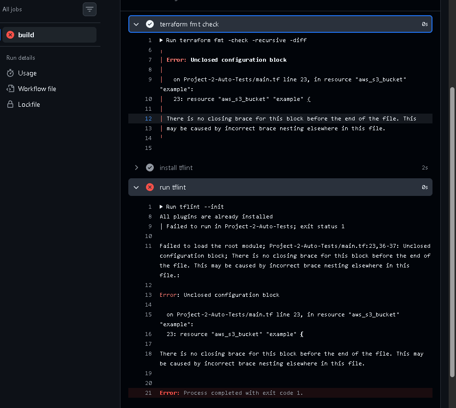
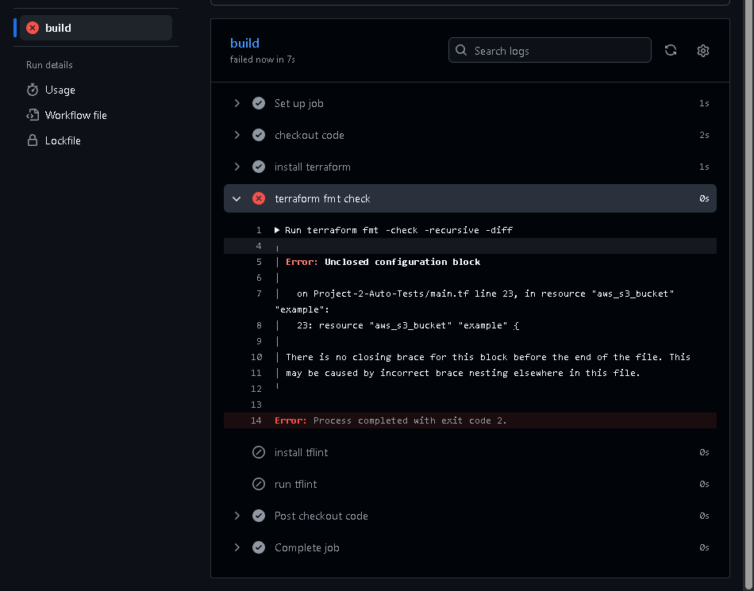

# Create a pipeline with automated tests e.g. linting for terraform

- Linting = automated process of code analysis to flag potential bugs, inconsistencies and violations of coding standards. 

1. Create a simple terraform script for the sake of the project:

- Setting provider and creating a simple S3 bucket. 

```go
terraform {
  required_providers {
    aws = {
      source  = "hashicorp/aws"
      version = "~> 6.0"
    }
  }
}

# Configure the AWS Provider
provider "aws" {
  region = "eu-west-1"

  default_tags {
    tags = {
      Project     = "ci/cd"
      Environment = "dev"
    }
  }
}


resource "aws_s3_bucket" "example" {
  bucket = "my-tf-test-bucket-zainab-123"

  tags = {
    Name        = "My bucket"
    Environment = "Dev"
  }
}

```

2. Create a `ci.yaml` file with the workflow. 

   - To actually get github actions to notice this file, needs to be in the root of the github repo in `.github/workflows`.


```yml

name: Zainab's automated testing pipeline

on: [push]

jobs:
  build:
    runs-on: ubuntu-latest

    steps:
    - name: install terraform
      uses: hashicorp/setup-terraform@v3
      with:
        terraform_wrapper: false
        # This wrapper ensures the pipeline ends here if error.

    - name: terraform fmt check
      run: terraform fmt -check -recursive -diff
      working-directory: Modules/8-CICD/Project-2-Auto-Tests
    
    
    - name: install tflint
      uses: terraform-linters/setup-tflint@v4

    - name: run tflint
      run: |
        tflint --init
        tflint --recursive
      working-directory: Modules/8-CICD/Project-2-Auto-Tests
    
      env:
        GITHUB_TOKEN: ${{ github.token }}

```
3. Create the error in terraform file
   - Removed the last curly bracket.
   - This should cause some problems with formatting etc. 


### EXPECTED RESULT: With error, pipeline should fail. 




- Add this to the workflow file to ensure it fails at fmt and doesn't pass it to tflint.




## Creating another error -
   - Adding an unset variable. Terraform fmt should pass but tflint shouldnt. 


### ERROR with git push: 

- Accidentally pushed .terraform folder and it failed - big files!

FIX: 

  - Add this to my .gitignore file: 
  
    ```
    .terraform/
    *.tfstate
    *.tfstate.*
    ```

  - `git reset origin/main` = undoes commits that haven't been pushed successfully yet. 
  - `git add .`
  - `git status`


